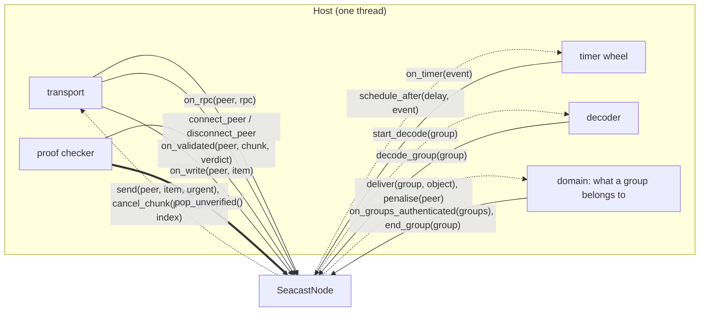
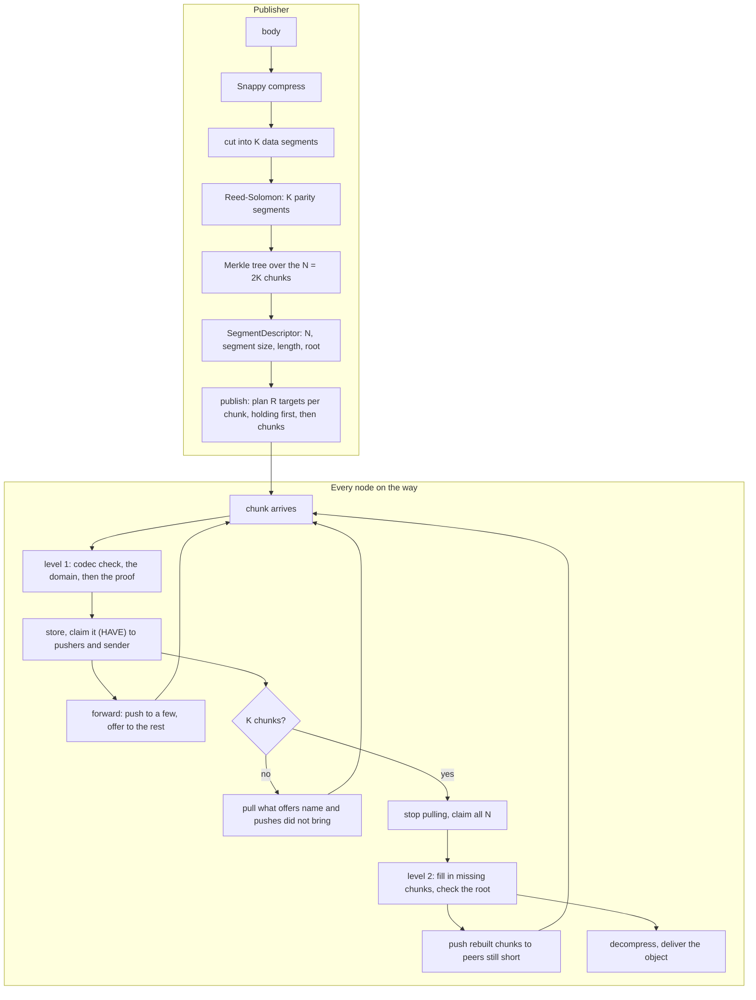
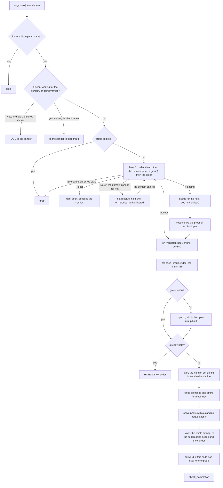
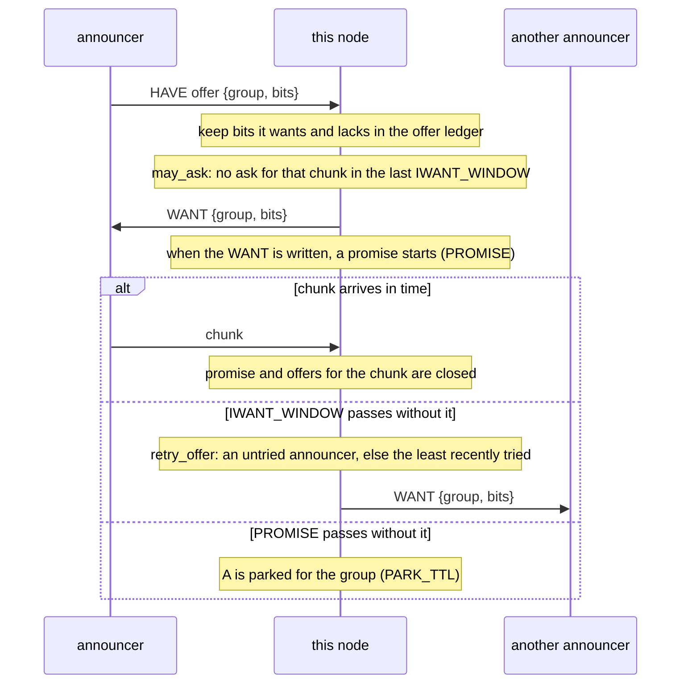
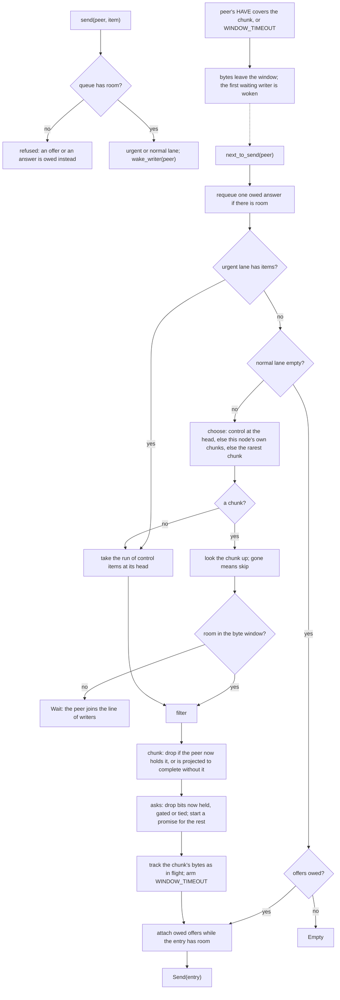
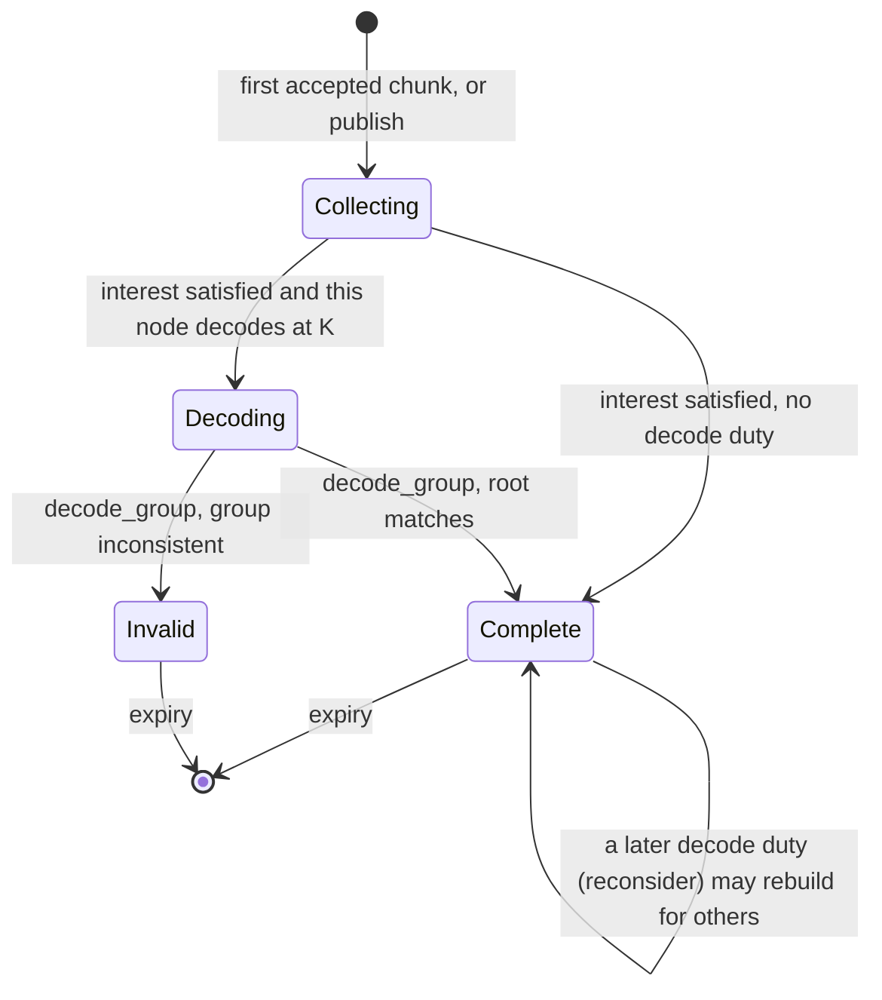
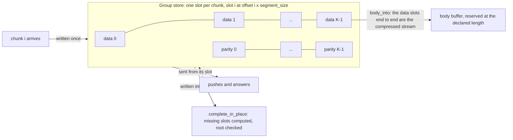

# `seacast-rs`

A Rust implementation of **SEACAST v2**: chunked, erasure-coded diffusion of large objects (the execution payload, data columns, rows) between peers. It follows `protocol-v2.md` and the rules that document carries over from `protocol.md`, from [Csaba Kiraly](https://www.github.com/cskiraly)'s `informed-diffusion-spec`  [repository](https://github.com/cskiraly/informed-diffusion-spec).

The protocol logic is a single-threaded state machine with no I/O. A host supplies the transport, the clock, the buffers and the domain's checks.

## Where this differs from the specification

- **Bitmaps are 1024 bits** (`BITMAP_WORDS` in `bitmap.rs`). `protocol.md` allows 8192 indices in a plain group and a HAVE bitmap. 1024 chunks carry a 16 MiB body uncoded, which is past what consensus gossip lets one message be; a group or an index beyond it is refused. Every table, message and queue item that holds a bitmap grows with the constant, which is why it is not 8192.
- **Evidence** (`[D6]`) is carried in the message types and not acted on. The specification carries it and does not define it.
- **The wire encoding** in `seacast-codec::wire` is this implementation's. `protocol-v2.md` §7 leaves the standalone binding's bytes open, and the gossipsub bindings are not implemented.
- **The chunk's layout** is `type | group | index | frame`, with the frame `header | context | proof | data`. The specification's `Chunk` has `slot` and `beacon_block_root` as fields of their own and an optional descriptor; here they are the payload's context, and a header is present or absent by type.
- **The group id** is `sha256(0x03 || type || header id || context)`. The specification's `group_key` is `sha256(0x03 || group id || slot)`: the type and the block root are not bound.
- **The chunk id** is the specification's formula (group, index, and the Altair message id over a topic) over the chunk as it is sent here, not over the SSZ `Chunk`. The topic is the domain's, one a type.
- **The gate** is one call, `on_groups_authenticated`, where the specification has `on_block_installed` and `on_header_validated`.
- **Level 1** is three steps where the specification has one `validate_chunk`: the codec's check of the chunk alone, the domain's answer on the group, then the proof. The domain is asked once a group and its answer is kept, so later chunks of an authentic group run only the codec's steps.
- **The live window** is a deadline the domain gives a group (`Domain::deadline`), a time on the host's clock, where the specification has the group's slot. A group and its deferred chunks go at the deadline at the latest, and its tombstone is kept until it. A group with no deadline has only the node's lifetimes: a deferred chunk goes `GROUP_TTL` after it arrived and a tombstone after `tombstone_ttl`.
- **Standalone types** are new: one chunk a group, no header and no proof, with the group id `sha256(0x04 || type || frame)` and a level 1 that is that hash, index 0 and a length limit. The specification defines no type without a header.
- **The send queue and window** (`protocol-v2.md` §4.11, §4.12) are not in the node. The node hands each item to the host with `send` and filters it in `on_write`; `SendQueues` implements the specification's queue and window beside it, and a host may replace it.
- **Serving** has two checks the specification's `on_want` does not have: an ask for an index this node neither holds nor has interest in, as the peer sees that interest, is refused and penalised (`AskOutsideOfferOrInterest`), and at most `max_served_per_heartbeat` chunks are served in a heartbeat over all peers, beside `SERVE_LIMIT` per peer and group.
- **The claim at K** is what the type's codec says a node can produce from the chunks it holds (`TypeCodec::producible`), where the specification's `claim_group` sets all `N` bits. The default is all `N`, and a holding carries `claim_all` only when its bitmap is whole.
- **`data_only_root`** (a cargo feature of `seacast-codec`, off by default) replaces the commitment of a coded group. The descriptor has two roots, one over the `K` data chunks and one over the `N - K` parity chunks, and a chunk's proof is a path in its own tree. Level 2 checks the data root and computes no parity, where the specification re-encodes and checks one root over all `N`. A node then holds the data chunks and the parity it received, claims those without `claim_all`, and repairs with data chunks only. The descriptor is 32 bytes longer, so group ids and the wire differ from a build without the feature. See "Completion, decode and delivery".
- **State a peer can create** has limits the specification leaves open or does not name: `max_pairs` and `max_wide_pairs` on (peer, group) records, and `max_relations_per_link`.

## Crates

| crate | what it is |
| --- | --- |
| `crates/seacast-core` | The state machine, `SeacastNode`: relations, chunk handling, push, pull, repair, the send window. No dependency but `fxhash`. |
| `crates/seacast-codec` | What a segmented object type needs: segmentation, Snappy, Reed-Solomon over GF(2^8), SHA-256, the Merkle tree, and a wire encoding of the messages. |
| `crates/seacast-sim` | Everything specific to the domain: the type ids (payload, column, row), the payload type's catalog, and a discrete-event simulator that runs the five settings of `protocol-v2.md` §6.2 and checks the protocol's invariants. |

## The host's contract

`SeacastNode` never blocks, spawns nothing and holds no lock. Every entry point takes `&mut self`, so one thread owns a node and calls it from its own loop.



Solid arrows are calls into the node. Dotted arrows are `RuntimeEnv` callbacks: they only record what the host should do. The thick arrow is polled by the host. The node keeps no send queue: it hands each item to the host with `send`, and the host passes an item to `on_write` as it writes it.

The traits a host implements, in `seacast_core::traits`:

| trait | role |
| --- | --- |
| `ChunkBuffer` | A handle to a chunk's bytes. The node stores, clones and compares handles and asks only `len()`. It never reads the bytes, so a handle may be a reference into a ring cache. |
| `RuntimeEnv` | Clock, timers, the send path's callbacks, decode trigger, delivery, penalties. |
| `TypeCodec` | The networking mechanics of the object types: how a chunk's frame is laid out, its index count and threshold, the checks that need no outside knowledge, decode, projection onto groups. |
| `Domain` | What a group belongs to, whether that is authentic, and when its window closes. Asked once a group, with the id of the group's header and the chunk's context bytes. |
| `Policy` | What this node takes part in: its types, interest, duty and parameters (`TypeParams`). |
| `ObjectCatalog` | The three together: what the node is given. |
| `DeferredStore` | Reservations for chunks that wait for the domain's word on their group. |
| `RngSource` | Randomness. |

## An object's life



A group is one object's chunks. Its id is known before any chunk of it exists, so peers exchange bitmaps about it and ask for it from the start.

The node knows nothing of blocks, slots or headers. A chunk is its type, its group, its index and a frame of bytes the node never reads:

```text
type      u16
group     32 bytes
index     u32
frame     header | context | proof | data     laid out by the type's codec
```

Every length in the frame follows from the type and the header, so no field carries one. A type may have no header, no context or no proof. The context is what the domain reads (for the payload, a slot and a block root); the codec only knows its length. A group id binds the three: for a segmented type it is `sha256(0x03 || type || header id || context)`, and the header id is what the domain commits to.

## Receiving a chunk

`on_rpc` handles an RPC's parts in a fixed order: joins, the chunk, offers, asks, grafts, prunes, holdings, then one combined response. A message for an object type the peer has not joined on the link is ignored.



A deferred chunk resumes when the host calls `on_groups_authenticated` with its group: for the payload when its block is installed, for a cell group when its header is validated, which may be earlier. The domain is asked once a group; later chunks of an authentic group need only the codec's checks.

Nothing is stored, claimed or forwarded before level 1 passes. Level 1 has three parts, in the order of their cost. `TypeCodec::check` needs only the chunk: the group id is that of its type, header and context, the index is one the header has, the length is what the header says. `Domain::authenticate` says whether the context commits that header. `TypeCodec::check_proof` reads the data (a Merkle path, a KZG proof); it may answer `Pending`, and the host then checks it and reports through `on_validated`.

`forward` works per group the chunk fills: its candidates are the push relation's peers for the chunk's colour that do not hold it and want it. It pushes to `R_NODE` minus the known holders, chosen furthest-behind first, and offers the chunk to the rest.

## Pulling what did not arrive

An offer (a HAVE with `offer = true`) says "you may ask me for these". The node asks one peer at a time per chunk.



Asks for one offer leave as the bits of one WANT, so none is left behind however many indices it names. When every announcer of a chunk is parked, a last-resort timer asks one of them again, with a doubling wait. Nothing is asked for before its group can be authenticated.

## Sending

The node does not queue. It hands the host each item to send with `RuntimeEnv::send(peer, item, urgent)`; an item is small: a chunk's key `(group, index)` or one control message. Order, batching and flow control are the host's. When the host writes an item it calls `SeacastNode::on_write(peer, item)`, which returns the frame, or `None` if the item is no longer to be sent, and starts the promise of an ask.

The other send callbacks have defaults that do nothing, so a host implements the ones its send path can use:

| callback | meaning |
| --- | --- |
| `cancel_chunk(peer, group, index)` | the peer holds the chunk: a copy waiting to be sent to it is not needed, and one in flight has arrived |
| `cancel_asks(peer, group, bits)` | the asks for these indices waiting to be sent are withdrawn |
| `cancel_group(group)` | the group has ended: nothing of it is to be sent |
| `owe_offer`, `owe_answer` | an offer or an answer `send` refused is still owed to the peer |
| `merge_holding(peer, have)` | merge a holding into one of the same group still waiting, if there is one |
| `ask_waiting(peer, ask)` | whether an ask is waiting to be sent, so that it is not made twice |

`SendQueues` (`queue.rs`) is the reference send path, which the simulator and the tests use: the queue and window of `protocol-v2.md` §4.11 and §4.12. A host keeps one beside its node and gives the node `SendQueues::env(&mut env)` as its environment, or wraps its environment in `WithQueues`. Each peer has a queue with two lanes: urgent (holdings, joins) and normal (chunks, offers, asks, relation control). The entry that goes on the wire is built when it is sent.



`SendQueues::next_to_send` returns `Send(entry)`, `Wait` or `Empty`. An entry carries at most one chunk, whose frame is one buffer handle, plus control messages. The window is in bytes and node-wide; control takes no room in it. Because the chunk is chosen at the moment of sending, a host that polls keeps the late choice: while the window is full, items wait and the rarest goes first when room returns.

## Completion, decode and delivery



At K chunks the node stops pulling and claims all N before decoding: a group that fails level 2 fails at every node, so the claim can only be wrong about a group everyone drops. `start_decode` tells the host; the host calls `decode_group` when it is ready, which runs `catalog.decode`, stores the rebuilt chunks, fills the other groups a chunk belongs to, pushes rebuilt chunks to peers still short, and delivers.

With `data_only_root` the claim at K is the data indices and the parity held, with `complete` set and `claim_all` clear, and `decode_group` stores only the data chunks it rebuilt. A data root that matches proves the parity chunks decoded from; a parity chunk held and not decoded from has passed level 1 only. Parity that is committed and is not the code's fails only the decodes that read it: a node that reaches K with such a chunk fails the data root and drops the group, as it does without the feature. It does not go on to collect the data chunks (`NOTES.md`).

`SegmentedCodec` in `seacast-codec` is the `TypeCodec` of a segmented type: its trait `check_proof` answers `Pending`, and `SegmentedCodec::check_proof` is the Merkle check the host runs. `PayloadCatalog` in `seacast-sim` is the payload object type for a node: a `SegmentedCodec`, a `Domain` that asks its `PayloadHost`, and the node's policy. `crates/seacast-sim/tests/payload.rs` runs real groups through a node with it, with a host that plays the consensus side.

A host that keeps chunks in a slot store uses the codec's slice-level functions, which decode a group where its chunks already lie:



The code is systematic, so the K data slots are the Snappy stream itself. If every data chunk arrived, no Reed-Solomon runs. Otherwise only the missing slots are computed. Hashing follows the same rule: level 1 has already proved the leaf digest of every chunk that arrived, the host keeps it (32 bytes a chunk), and level 2 hashes only the chunks it computed before it rebuilds the tree's upper nodes and compares the root. The node's own decode does the same: `SegmentedCodec::check_proof` leaves the digest in the chunk's `memo`, a field of `ChunkMsg` the node carries and does not read, and `decode_and_reencode` takes it for the K chunks it decodes from. A chunk's bytes therefore move twice: from the network into its slot, and from the slots into the decompressed body.

| function (`seacast-codec`) | what it does |
| --- | --- |
| `SegmentedCodec` | the `TypeCodec` of a segmented type, over the functions below |
| `build_group` | body to descriptor and shards, at the publisher |
| `group_id`, `group_key` | a descriptor's id, which the domain commits; a group's id from its type, that id and its context |
| `split_frame`, `build_frame`, `build_chunks` | a segmented chunk's frame taken apart and put together; a group's chunks as a publisher hands them to the node |
| `check_frame`, `check_frame_proof`, `frame_leaf_hash` | level 1 for one chunk: descriptor, group id, index and length; then the Merkle proof. `frame_leaf_hash` is the proof check that returns the leaf digest it proved |
| `chunk_id` | a chunk's id: group, index, and the Altair message id over a topic and the chunk as it is sent |
| `standalone_group`, `check_standalone` | a type with one chunk a group and no header or proof: its group id is the hash of its frame |
| `complete_in_place` | level 2 on a slot store: fill in what is missing, hash it, check the root with the digests level 1 proved for the rest, return the tree for proofs. With `data_only_root`: the missing data only, and the data tree |
| `body_len`, `body_into` | the object's length, and its bytes written into a caller's buffer |
| `encode_rpc_framing` | a message's bytes except the chunk's data, which is the frame's last field, for a gathered send |
| `decode_rpc_with` | decode with a closure that turns a range of the input into a buffer handle, so nothing is copied |

`build_group`, `decode_and_reencode`, `encode_rpc` and `decode_rpc` are the versions for hosts that keep each chunk in memory of its own (`Vec<u8>`, `Arc<[u8]>`).

## A group's lifetime

A group's state lives `GROUP_TTL` after its last chunk or its completion. The domain may give a group a deadline (`Domain::deadline`, asked with `authenticate` on the group's first chunk): the time its window closes, a slot boundary say. The group then goes at the deadline if that is sooner, and the host may end any group at once with `end_group`. When a group goes, one record is removed, with the pull state that named the group, and a tombstone keeps the group from being taken up again: until its deadline, or for `tombstone_ttl` if it has none. A deferred chunk goes at its group's deadline, or `GROUP_TTL` after it arrived. From the deadline on the domain answers `Ignore` for the group, as it does for one that is too early. A group known only from offers has no deadline until its first chunk.

## State

| kept per | where | holds |
| --- | --- | --- |
| group | `groups: Groups`, one `Group` record | type, header, state, the received, rebuilt and held bitmaps, interest, timestamps, claims, probe and repair sampling |
| chunk | `chunks`, `known_id`, `holders`, `standing` | the handle and id, who holds it, who asked for it ahead of its arrival |
| ask | `offers`, `tried`, `promises`, `asked_at` | announcers in order, whom was asked and when, running promises |
| peer and group | `pairs: Pairs`, one record a pair | what the peer holds, what was pushed and sent to it, its offers, its park; bitmaps of 128 bits in the record, wider ones in a pool |
| peer | `join_*`, `named` | the link's declarations |

All tables are sized once, in `SeacastNode::new`, from `CapacityConfig`, and nothing allocates afterwards; a test in `crates/seacast-core/src/lib.rs` counts allocations to check it. Maps are fixed-capacity `FxHashMap`s.

A full table refuses a new key instead of failing, and state a peer can make the node keep is admitted against a limit first:

- groups without a header that a peer names: `max_pending_groups` per peer;
- groups that are only named and groups that are open: `max_groups` each, counted apart, so naming groups cannot stop real ones from opening;
- push relations on one link: `max_relations_per_link` per direction;
- ties to groups the domain cannot tell of yet: `max_pending_groups` per peer.

## Building and running

```bash
cargo test                                         # unit, limit and simulation tests
just fmt                                           # rustfmt, on the pinned nightly
just clippy                                        # clippy, warnings denied
cargo run --release -p seacast-sim                 # the five settings of protocol-v2.md §6.2
cargo run --release -p seacast-codec --example bench   # timings of the codec's hot paths
cargo test --release --workspace --all-features    # the same tests with data_only_root
```

`just clippy` passes `--all-features`, so it lints the `data_only_root` build. Lint the default build with `cargo clippy --no-deps --all-targets -- -D warnings`.

`.cargo/config.toml` sets `-C target-cpu=native`. The codec picks its SHA-256 and GF(2^8) kernels by `cfg(target_feature)`: SHA-NI or the ARMv8 SHA2 instructions, a 16-lane AVX-512 SHA-256 for Merkle leaves with SHA-NI on four leaves at a time for those that do not fill its batch, and GFNI, AVX2 or NEON for Reed-Solomon, each beside a portable arm. Without that flag every build takes the portable arms, and with it a binary is tied to the CPU it was built on.

Parity is computed two ways, with the same bytes. The general one multiplies the data by the generator matrix: K products a parity byte. When K is a power of two the points `0..2K` are closed under XOR, and an additive FFT (Lin, Chung and Han) gives all K parity chunks in K log K products a byte column. `rs_parity_rows` takes it for a `(K, 2K)` code with such a K when enough parity rows are asked for; every other K, and a few missing rows, stay on the matrix. Recovery of missing data chunks is always by matrix; its coefficients are Lagrange basis values in closed form, so nothing is inverted. On the GFNI arm the matrix path computes up to eight output chunks in one pass over the inputs.

## Layout of `seacast-core`

| module | contents |
| --- | --- |
| `node.rs` | `SeacastNode`: its tables, peer lifecycle, `on_rpc`, `on_timer`, admission |
| `relations.rs` | joins and the coloured push relation: `on_join`, `on_graft`, `on_prune`, `maintain_relations` |
| `groups.rs` | chunk arrival, validation routing, deferral and ties, completion, decode, expiry |
| `push.rs` | holdings, `forward`, `choose_push`, `announce`, `publish` |
| `pull.rs` | offers, asks, promises, parking, serving |
| `repair.rs` | holdings from peers, claims and the probe, repair pushes, sampler pulls |
| `gossip.rs` | the heartbeat, gossip, heartbeat-counted lifetimes |
| `window.rs` | `on_write` and the filter applied to an item as it is written |
| `queue.rs` | `SendQueues`, the reference send path: the per-peer queue, the byte window, `next_to_send` |
| `state.rs` | `Group`, `Groups`, `Pairs`, `PeerQueue`, `AskPeers`, `GossipHistory` |
| `message.rs`, `types.rs`, `traits.rs` | messages, parameters, the host's traits |
| `bitmap.rs`, `collections.rs` | the bitmap and the fixed-capacity collections |
